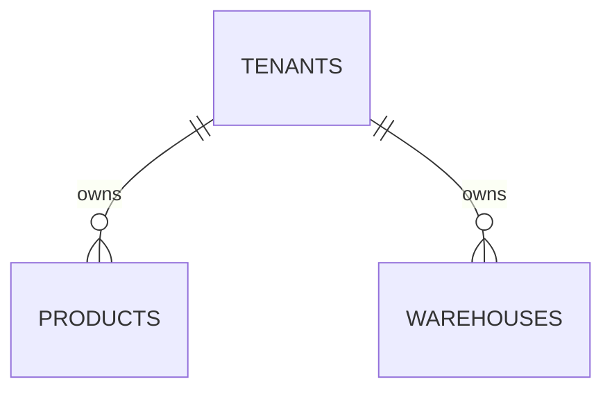

# Database architecture

**Scope:** Sprint 02 Groups A–D: database foundation, Better Auth identity tables,
tenant memberships, active company context and database-backed Products. RLS,
stock, orders and category/unit lookup tables remain deferred.

## Entity relationships

All identifiers are PostgreSQL-generated UUIDs. Business-owned rows contain a
non-null `tenant_id`; product and warehouse tables also expose unique
`(tenant_id, id)` pairs for future composite tenant-safe foreign keys.

## Tables

Group C adds `tenant_memberships`, `session_tenant_context`, `onboarding_requests`,
and `tenant_creation_rate_limits`. Their constraints, bootstrap-query exceptions,
onboarding transactions, rate/retry semantics, and authorization boundaries are
documented in [tenant architecture](tenancy.md). Migrations `0003_regular_thunderbolts`
and `0004_tenant-context-triggers` are additive and preserve existing records.

Better Auth owns `user`, `session`, `account`, `verification`, and `rate_limit`.
They intentionally have no `tenant_id`: they store identity and authentication
state, not tenant-owned business data. Their generated identifiers and lifecycle
are controlled by Better Auth. All auth date columns were reviewed to use the
project-standard UTC `timestamptz` storage supported by the official Drizzle
adapter.

### `tenants`

- Required trimmed `name`, uppercase three-letter `base_currency`, and non-empty
  `timezone` (default `Asia/Dubai`).
- Status is `ACTIVE` or `INACTIVE` and defaults to `ACTIVE`.
- `created_at` and `updated_at` are millisecond-precision `timestamptz` values.
- Index: `(status, created_at DESC, id)` for administrative lifecycle listings.

### `products`

- Required tenant, canonical SKU, trimmed name, extensible `category_code` and
  `unit_code`, status, and timestamps.
- Unique constraints: `(tenant_id, sku)` and `(tenant_id, id)`.
- Tenant FK uses `ON DELETE RESTRICT` and `ON UPDATE RESTRICT`.
- Index: `(tenant_id, created_at DESC, id)` for tenant-scoped pagination.

Category and unit codes are uppercase identifiers matching
`[A-Z0-9][A-Z0-9._/-]*`; they are not restricted to synthetic demo values.
Tenant-owned lookup tables, localized category metadata, category referential
integrity, unit dimensions, and unit conversion rules are deferred until those
features have approved behavior.

SKU input is normalized in this order: Unicode NFKC, surrounding-whitespace
trim, whitespace-run collapse to one ASCII space, then uppercase conversion.
Validation runs after normalization. The stored value is 1-64 characters and
contains only printable ASCII, optionally separated by single spaces. The
database independently rejects lowercase, surrounding or repeated spaces,
control characters, and non-ASCII values. Original formatting is not retained
in V1; external supplier identifiers may require a separate original-value field
in a future integration design.

### `warehouses`

- Required tenant, uppercase code, trimmed name, status, and timestamps.
- Unique constraints: `(tenant_id, code)` and `(tenant_id, id)`.
- Tenant FK uses `ON DELETE RESTRICT` and `ON UPDATE RESTRICT`.
- Index: `(tenant_id, name, id)` for tenant-scoped lists.

Products and warehouses are archived by changing status to `INACTIVE`; no Group
A service performs hard deletion.

## Timestamp enforcement

The version-controlled `set_updated_at` PostgreSQL trigger function runs before
every update on all three tables. It restores `created_at` from the old row and
sets `updated_at` to `GREATEST(clock_timestamp(), OLD.updated_at)`. This records
wall-clock update time while preventing clock changes or supplied values from
moving the timestamp backwards. Database enforcement also covers scripts and
future writers that bypass application helpers.

## Migrations

Drizzle schema files are the structural source of truth. Drizzle Kit generates
version-controlled SQL and snapshots under `apps/web/drizzle`; custom migration
`0001_updated-at-triggers.sql` owns the trigger function and triggers. Apply
migrations with `db:migrate`. Never use `drizzle-kit push` for shared or
production databases, and never edit an already-applied migration.

## Docker databases

- `postgres` uses the preserved `postgres_data` named volume and publishes only
  to host loopback for development tools.
- The web container connects to `postgres:5432` through Compose networking.
- `postgres-test` has no published port and stores data on an ephemeral `tmpfs`.
  Tests refuse to reset any URL whose host is not local/`postgres-test` or whose
  database name is not exactly `makhzan_test`.
- GitHub Actions uses a separate ephemeral PostgreSQL 16 service and synthetic
  credentials; it never connects to development or production databases.

## Integration coverage

The real PostgreSQL suite resets only the guarded test database, applies every
migration, and verifies table creation, constraints, indexes, triggers, UUID
defaults, required fields, tenant-scoped SKU and warehouse uniqueness,
cross-tenant SKU reuse, foreign keys, deletion restriction, tenant-filtered
queries, extensible codes, SKU normalization/collisions, and repeated/concurrent
timestamp updates.

## Known limitations and deferred decisions

- Tenant filters and service authorization are required in business queries.
  Identity, memberships, and RBAC are implemented; PostgreSQL RLS is deferred.
- Future stock tables must reference products and warehouses with composite
  `(tenant_id, resource_id)` foreign keys.
- Group D uses the existing product table for authorized CRUD and server-side
  queries, without a new migration or automatic seeds. Category/unit lookup CRUD
  is deferred. See [Products architecture](products.md).
- B-tree indexes cover known tenant access patterns. Full-text/trigram search,
  partitioning, replicas, and advanced pooling require measured demand.
- Memberships reference Better Auth's text user identifier without duplicating or
  modifying the authentication schema. Company IDs remain PostgreSQL UUIDs.
