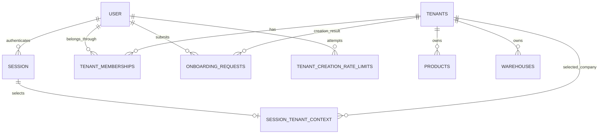

# Tenant architecture

Scope: Sprint 02 Group C. Makhzan owns tenant membership, company onboarding,
authorization, and active company selection. Better Auth remains the sole identity
and session implementation. No Organization Plugin, membership invitations, RLS,
Products CRUD, inventory transactions, billing, or extra dependencies are added.

## Data model

- `tenant_memberships`: primary key `(tenant_id UUID, user_id TEXT)`; checked
  `OWNER/MANAGER/STAFF/VIEWER` role and `ACTIVE/INACTIVE` status; UTC timestamps.
  Tenant and auth-user deletion are restricted, preventing user deletion from
  cascading through the last OWNER. The user-first index and membership discovery
  query are approved bootstrap exceptions: they filter only by the authenticated
  user, before a tenant can be selected. Business-data queries remain tenant scoped.
- `session_tenant_context`: one selected tenant per Better Auth session, with an
  integer version and UTC timestamps. Session deletion cascades; tenant deletion
  is restricted. Selection is a hint, never proof of membership. A database trigger
  increments the version on every update; callers cannot move it backwards.
- `onboarding_requests`: successful receipts keyed by `(user_id, operation_id)`;
  normalized-input SHA-256 fingerprint and resulting tenant. Receipts are written
  atomically with the company, OWNER, and session context.
- `tenant_creation_rate_limits`: authenticated attempt ledger keyed by
  `(user_id, operation_id)` with fingerprint and actual attempt timestamp. A
  user/time index supports the five-new-attempts-per-ten-minutes limit. Retaining
  operation IDs also makes failed retries free after the time window expires.
  This is auth-scoped control data and may exist before a tenant does.

Mutable membership/context timestamps reuse PostgreSQL `set_updated_at`, preserving
`created_at` and preventing backwards time. Existing company UUIDs, tenant-safe
business foreign keys, indexes, and data remain unchanged. Existing unassigned
companies remain inaccessible; no migration automatically claims them for a user.

## Onboarding and retry semantics

Authentication and exact trusted mutation origin are mandatory. Zod rejects unknown
fields, client role/user/tenant injection, invalid currency, and invalid IANA
timezone. Company names are trimmed; currencies normalized uppercase. Supported
currency/timezone values come from the runtime ICU data, not synthetic Products.

1. Lock the authenticated user row `FOR NO KEY UPDATE`, serializing onboarding
   across all their sessions. Recheck the same session's identity and expiration
   under a row lock.
2. Check a matching successful receipt before eligibility or quota. The same key
   with another fingerprint fails. Valid replay rechecks current company and
   membership status and never changes a newer active-company selection.
3. Recheck eligibility: any membership, even inactive, or a previous creation
   receipt blocks a new first-company request. Membership in someone else's
   company also blocks creation. Multi-company membership/selection is supported;
   creating additional companies is deferred.
4. Reuse an existing matching attempt without charging quota. Reject changed input
   with that attempt ID. For a new operation, count recent attempts and insert one
   record if fewer than five exist. Attempts are serialized, database-persistent,
   and cannot be bypassed with spoofed IP headers.
5. In a savepoint, create Tenant, OWNER Membership, Session Context, and Receipt.
   Failure rolls back all four. The outer transaction commits the single attempt
   record, so a failed request cannot bypass quota and its correct retry is free.
6. Return a safe result. An ambiguous network failure is recovered by retrying the
   same operation/details. The form retains its operation in per-tab storage where
   available, with in-memory fallback. A deliberate changed submission requires a
   new operation. Disabled buttons are only a UX measure.

First-company eligibility and exact idempotency are server/database decisions.
Attempt/receipt retention currently has no automatic pruning; any future retention
policy must preserve the documented retry guarantees. First-company throttling
does not replace verified email and deployment ingress protections for public use.

## Active tenant and access policy

New accounts and users with no eligible memberships go to `/[locale]/onboarding`.
An existing membership/receipt still prohibits first-company creation: these users
see a localized no-access/contact-owner state, not a creation form. Inactive
memberships/tenants are excluded from selection. No other company's details appear.

For a session with no context row, exactly one eligible company is established by
`resolveCompanyEntryAction`, an authenticated, trusted-origin POST with no client
tenant/role selector. Sign-in calls it before a single locale-aware navigation.
Direct protected-page visits use a neutral opening-workspace boundary that invokes
the same action after hydration; no company-selection form flashes. Rendering,
prefetching, and GET requests only read context and never select a company.

The entry transaction locks the authenticated user (UPDATE), then session, then
related tenants and memberships, including inactive rows, before counting eligible
companies. The user lock blocks membership foreign-key inserts; tenant/membership
locks serialize status changes. This is a bootstrap-only extension of the normal
lock order, consistent with onboarding's user-before-session ordering. Concurrent
entry requests insert at most one context. Existing valid contexts are preserved
without updates, so refreshes/retries never increment the version or timestamp.

Multiple eligible memberships without a selection require explicit selection.
An existing but invalid context is never automatically replaced, even if just one
alternative remains. Show an unavailable-company notice and require explicit
recovery (or no-access onboarding if none remain). A valid existing selection
always opens Dashboard. `pending-setup` remains a read-only compatibility redirect.

Every protected operation validates the Better Auth session, selected tenant,
current membership status/role, tenant status, and required permission. Layout and
page guards both run before protected content; the synthetic Products API checks
independently. Authorization is never stored in a shared cache or trusted from
client state. Server Components call server-only services directly.

Switching is an authenticated, origin-checked Server Action. A supplied tenant ID
is only a selector and must match a current active membership. Sensitive mutations
carry the displayed context version as a stale-intent check; the authoritative
tenant still comes from the server session context. Another tab's switch makes the
old version invalid. Company selection is shared within a session; independently
signed-in sessions can choose differently. UI/company labels refresh after a switch.
The responsive Header displays company and role. Multiple eligible memberships
enable an accessible Radix dialog/sheet with current-company indication, keyboard
navigation, Escape/close, and focus return. A single membership renders a static
label, not a switch action. Choosing the current company closes without a mutation.

Dashboard and Products require an active membership. Products remain the same
synthetic, clearly labeled demo catalog for all roles; tenant IDs in URLs/headers
never select real Products records. No database-backed Products operation exists.

## Permissions and concurrency

`src/lib/tenancy/permissions.ts` is the type-safe resource/action matrix. OWNER has
all defined permissions. MANAGER manages business operations/reports but not
members, company settings, or billing. STAFF has business reads and operational
order/stock tasks, not catalog maintenance, reports, or administration. VIEWER has
reads, including reports, and no writes. Future permission definitions do not
create those features. Navigation filtering is only UX.

Member role/status updates exist only as a server-only service. There is no public
member-add, invitation, role-management, or billing endpoint/UI. Only OWNER can
administer existing members, always in the current tenant; other roles cannot
self-promote. Fixtures provide additional memberships for security tests.

Lock order for protected operations is session, context, tenant, then membership.
Session/context locks pin the selection and serialize switching/logout. Reads hold
shared tenant/membership locks; administration locks the tenant exclusively before
reading actor/target roles or counting active OWNERs. All role/status changes use
this lock boundary, so concurrent demotion/revocation cannot remove the last active
OWNER. A mutation revalidates inside its transaction after any wait.

Revocation committed before an operation's authorization causes denial. An already
authorized transaction may complete before revocation commits; there is no promise
of retroactive cancellation. SQL constraints alone do not implement RBAC or a
cross-row last-owner invariant. Manual SQL writers must respect the services'
invariants; RLS and broader privileged administration remain deferred.

## Migration reversal considerations

Migrations `0003` and `0004` are additive and do not rewrite existing business or
authentication rows. There is no automatic down migration. Once onboarding has
occurred, dropping the four new tables would destroy membership, context, and
idempotency records; it is not a safe routine rollback. Prefer a reviewed forward
correction. Any reversal requires a verified backup, a coordinated application
release that preserves authorization, and a separately reviewed data plan.
Reverting only `0004` would remove timestamp/context-version protection and is not
compatible with the running Group C application. Do not edit applied migrations,
reset development data, or remove Docker volumes to reverse this feature.

## Verification

Guarded real-PostgreSQL tenancy tests exercise a Group B-to-C migration upgrade,
preservation/unclaimed companies, database constraints/triggers, rollback at each
creation stage, successful/failed retries, concurrent first-company attempts,
rate-window expiry, role permissions, cross-tenant reads/mutations, forged/stale
contexts, multiple sessions/memberships, expiration, revocation, and final OWNER
races. Existing unit/database/auth/HTTP suites remain enabled.

HTTP tests run real production Next.js servers and invoke compiled Server Actions
for onboarding, replay, CSRF/auth/input rejection, selection, stale versions, and
revocation, plus English/Arabic protected pages. Browser verification is separate
evidence: company-selection UX automation is blocked by execution policy, and
multiple-company/revocation browser scenarios are not manually verified. The
[verification record](../verification/group-c-company-selection.md) tracks user
manual results without treating HTTP/component tests as browser passes.

CI adds `test:tenancy` to the existing job and retains all checks. Local workflow
validation is not a GitHub-hosted execution. Production registration/recovery and
trusted-ingress limitations from the authentication architecture still apply.
